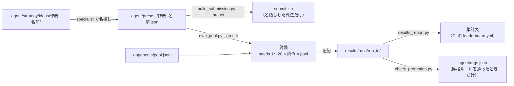

# フォルダの分け方

どこに何があり、誰が変えてよいかをまとめます。手順は [`PARALLEL_DEV.md`](PARALLEL_DEV.md)、
ルールの正本は [`../CLAUDE.md`](../CLAUDE.md) です。

## 全体の形

```
.
├── AGENTS.md                 Claude 以外のエージェントの入口
├── CLAUDE.md                 ルールとコマンドの正本
├── README.md
├── CHANGELOG.md              changelog.d/ から生成
├── changelog.d/              CHANGELOG の断片（1件1ファイル）
├── agent/                    提出する zip の元
│   ├── __init__.py           提出エントリ（必須4関数）
│   ├── main.py
│   ├── args.json             既定の args（昇格ルールで変える）
│   ├── config.json           modelConfig
│   ├── presets/              提出できる設定（1アイデア1ファイル）
│   └── strategy/
│       ├── __init__.py
│       ├── active.py         switchboard
│       ├── agents/           Agent クラス本体
│       ├── specialists/      共有の戦法
│       └── ideas/            アイデア（1つ1フォルダ）。_template/ が雛形
├── opponents/                対戦相手プール（pool.json と相手ごとの設定）
├── results/                  評価結果の正本
│   ├── SCHEMA.md
│   ├── schema/               manifest と試合行の JSON Schema
│   └── runs/                 1回の評価 = 1フォルダ（追記だけ）
├── scripts/                  ビルド、評価、集計、CI 用の確認
├── tools/                    提出ゲート（hooks/）、ログ解析、SIGNATE CLI、ダッシュボード
├── tests/                    pytest
├── local_test/               ペア評価と対戦記録
├── analysis/                 改善セッションの記録
├── docs/                     手順書（PARALLEL_DEV.md、REPO_LAYOUT.md）と PR・実験の資料（pr/、exp/）
├── .github/                  CODEOWNERS、workflows/（ci.yml、leaderboard.yml）
└── docker-compose.yml, pyproject.toml, uv.lock
```

`workspace/`（シミュレータ）、`data/`、`submission/`（ビルド出力）はコミットしません。

## 誰が変えてよいか

変えてよい人の区分は4つです。

- **共有コア**：後方互換の変更だけ。変えたら `scripts/check_core_compat.py` を通す
- **アイデアの作者**：自分の `<作者>_<名前>` のものだけ
- **CI のみ**：人は手で書かず、スクリプトが生成する
- **追記だけ**：新しいファイルを足すだけで、既存のものは書き換えない

レビューの欄は `.github/CODEOWNERS` の設定です。「MA と hosyan」は、`@mureee-18` と `@hosyan3279` がコードオーナーであることを示します。

| パス | 中身 | 変えてよい人 | レビュー（CODEOWNERS） |
|---|---|---|---|
| `agent/strategy/ideas/<作者>_<名前>/` | アイデアの戦法 | アイデアの作者 | 対象外 |
| `agent/presets/<作者>_<名前>.json` | アイデアを選ぶ args | アイデアの作者 | 対象外 |
| `results/runs/<run_id>/` | 評価の run（manifest と試合） | 追記だけ（`eval_pool.py` が書く） | 対象外 |
| `changelog.d/<日付>-<作者>-<話題>.md` | CHANGELOG の断片 | 追記だけ | 対象外 |
| `CHANGELOG.md` | 変更履歴 | CI のみ（`scripts/changelog.py` が生成） | 対象外 |
| 集計表（`results_report.py --out` の出力） | leaderboard.json、dashboard.json、index.html | CI のみ（コミットしない） | なし |
| `agent/args.json` | 既定の args | 昇格ルールを通ったときだけ | MA と hosyan |
| `agent/config.json` | modelConfig | 共有コア | MA と hosyan |
| `agent/strategy/active.py` | switchboard | 共有コア | MA と hosyan |
| `agent/strategy/agents/` | Agent クラス本体 | 共有コア | MA と hosyan |
| `agent/strategy/specialists/` | 共有の戦法 | 共有コア | 対象外 |
| `agent/__init__.py`、`agent/main.py`、`agent/strategy/__init__.py` | 提出エントリ | 共有コア | 対象外 |
| `opponents/` | 対戦相手プール | 共有（`pool` を変えると過去の昇格と比べられなくなる） | 対象外 |
| `results/SCHEMA.md`、`results/schema/` | results の形式 | 共有 | 対象外 |
| `scripts/` | ビルド、評価、集計、確認 | 共有 | MA と hosyan |
| `tools/hooks/` | 提出前ゲート | 共有 | MA と hosyan |
| `tools/`（hooks 以外） | ログ解析、SIGNATE CLI、ダッシュボードなど | 共有 | 対象外 |
| `.github/` | CODEOWNERS と CI | 共有 | MA と hosyan |
| `tests/` | テスト | 共有（アイデアの作者もテストを足してよい） | 対象外 |
| `docs/`、`AGENTS.md`、`CLAUDE.md` | 手順とルール | 共有 | 対象外 |

`agent/strategy/specialists/` は CODEOWNERS の対象外ですが、共有コアです。変えたら `check_core_compat.py` を通します。

## アイデアから集計表まで



1. アイデアの戦法を `agent/strategy/ideas/` に書き、プリセットがそれを `specialist` で名指しします。
2. プリセットから、提出用の zip と評価の対戦の両方を作ります。zip には名指しした戦法だけが入ります。
3. 評価は `opponents/pool.json` の相手と対戦し、`results/runs/` に新しい run を足します。
4. master に入った run から、CI（`.github/workflows/leaderboard.yml`）が集計表を作ります。
5. 既定を変えるときだけ、`check_promotion.py` が run を比べて `agent/args.json` の変更を通すか決めます。
