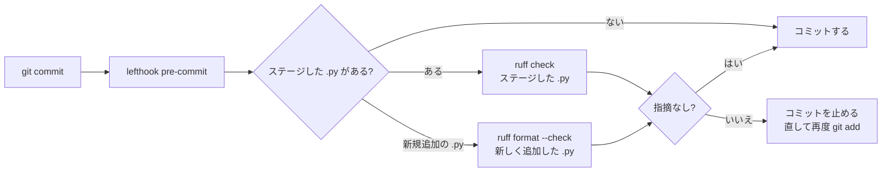

# コミット前チェック（Lefthook + Ruff）

`git commit` のたびに、ステージした Python ファイルへ Ruff を自動で掛ける仕組みです。
導入するかどうかは各自の任意です。入れなくても CI の lint はこれまでどおり動きます。

## 流れ



## 導入

```bash
uv sync                    # ruff と lefthook が dev 依存として入る
uv run lefthook install    # .git/hooks/pre-commit を作る
```

外す場合は `uv run lefthook uninstall` を実行します。

> git worktree を使っている場合、`.git/hooks` は全 worktree で共有されます。
> `lefthook.yml` がまだ無い古いブランチでコミットすると、lefthook は「設定ファイルが見つからない」と表示するだけで、コミットは通ります（lefthook 2.2.2 で確認）。

## 何をチェックするか

| ジョブ | 対象 | 内容 |
|---|---|---|
| `ruff-check` | ステージした `*.py` | `ruff check`（ルールは `pyproject.toml` の `[tool.ruff.lint]`。現在は `E`, `F`） |
| `ruff-format-new-files` | 新しく追加した `*.py` | `ruff format --check`（整形が必要なら止める） |

- 既存の `.py` を編集しただけのときは、書式（format）は検査しません。既存ファイルの多くは未整形で、触るたびに全体を整形させると戦略コードの差分が大きくなるためです。
- `workspace/`・`submission/`・`docs/pr/`・`docs/exp/` は `pyproject.toml` の exclude で対象外です。
- 既存ファイルでも、編集してステージすると `ruff check` の対象になります。いま master で指摘が残っているのは `tools/state_dashboard/serve.py` の F841（未使用変数）4件だけです（CI の lint もこの4件で失敗しています）。このファイルを編集するときは、先にこの4件を直すか、そのコミットだけ飛ばしてください。
- 止まったときは、指摘を直してから `git add` し直してコミットします。自動修正は `uv run ruff check --fix <file>`、整形は `uv run ruff format <file>` で行えます。

## 一度だけ飛ばす

```bash
LEFTHOOK=0 git commit -m "..."
# または
git commit --no-verify -m "..."
```
